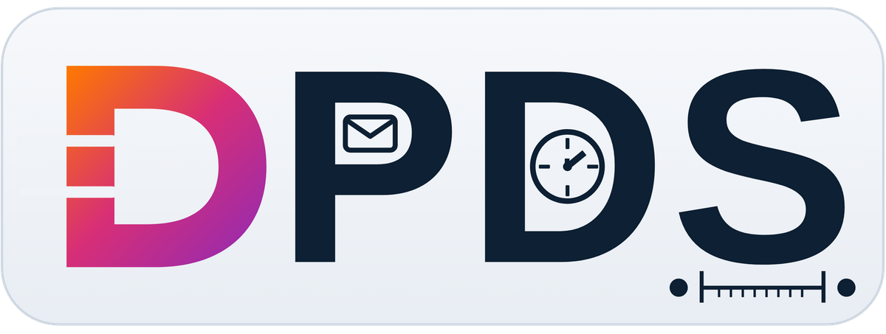
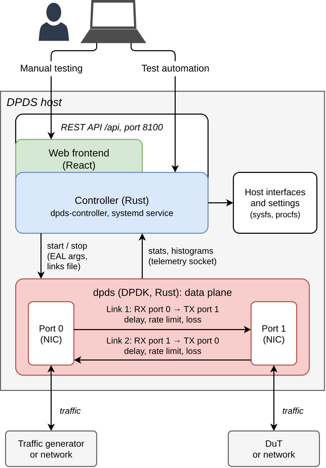

<div align="center">
  

  <h2>DPDS: A DPDK-Based Packet Delayer and Spacer</h2>

  
  
  
  
  
  [](https://github.com/uni-tue-kn/DPDS/actions/workflows/ci.yml)
</div>

---

## 📑 Table of Contents
- [📝 Overview](#-overview)
- [🚀 Installation \& Quick Start](#-installation--quick-start)
- [🖥️ Web Frontend](#️-web-frontend)
- [🔌 REST API](#-rest-api)
- [⚡ Performance](#-performance)
- [🔒 Security](#-security)
- [🔄 Update](#-update)
- [📚 Documentation](#-documentation)
- [🛠️ Development](#️-development)
- [📖 Cite](#-cite)
- [📜 License](#-license)

---

## 📝 Overview

**DPDS** is a software **network-link emulator** written in Rust on top of [DPDK](https://www.dpdk.org/).
It sits between network interfaces and applies **delay**, **rate limiting** and **packet loss** to a
live packet stream at line rate. On DPDK NICs (physical mode) packets are not copied and the kernel
stays off the fast path.

📖 Paper: [DPDS: A DPDK-Based Packet Delayer and Spacer](https://arxiv.org/abs/2606.17716) (arXiv:2606.17716)

- **Delay:** deterministic, normal, log-normal, gamma or uniform, optionally autocorrelated, with
  FIFO or send-time (reordering) packet order.
- **Rate limiting:** Spacer (spreads packets out) or Token Bucket Filter (drops excess).
- **Loss:** random or Gilbert–Elliott (bursty). An optional `seed` makes runs reproducible.
- **Directed links:** each direction has its own config. Two links make a bump-in-the-wire.
- **Statistics:** counters, drop causes, delay statistics and histograms.
- **Web frontend and REST API** to configure, start and stop DPDS (experimental).

<div align="center">
  
</div>

DPDS has two parts. The `dpds-controller` service serves the web frontend and the REST API on port
8100. It starts one `dpds` process for all links and reads its statistics. The emulation logic is
the library [`dpds-core`](crates/dpds-core/README.md).

---

## 🚀 Installation & Quick Start

### Requirements

- Linux with **DPDK 26.07 or newer** (`pkg-config libdpdk`).
- **Rust** (stable), and **clang and lld with the same LLVM major version as `rustc`**.
- **Node 26 or newer and npm.** The frontend is built on the host, which needs the npm registry.
- For real traffic: a DPDK-capable NIC (tested on Mellanox ConnectX) and hugepages.
- For real traffic: one **isolated core per link** (kernel parameter `isolcpus`), besides the main
  lcore. The controller refuses a start without them.

### Quick Start

`dpds.sh` builds and installs `dpds` and the controller, and runs the controller as a systemd
service. It checks the requirements first and never installs or tunes anything on the host. Run it
as your user, not with `sudo`. It calls `sudo` itself where needed.

```bash
git clone https://github.com/uni-tue-kn/DPDS.git && cd DPDS
./dpds.sh check                                   # requirements, then the host hints
./dpds.sh install --network physical              # build and install binaries and the systemd unit
./dpds.sh start                                   # enable and start the controller
./dpds.sh status                                  # also: stop, restart
./dpds.sh uninstall                               # keeps /etc/dpds/controller.env
```

> **Channels.** The default channel follows the branch `main`, which holds the releases.
> `--nightly` follows the development branch `nightly`, and `DPDS_CHANNEL=v1.0.0` pins one release.
> The channel is not stored, so pass the same flag to every `install` and `update`. The header of
> `dpds.sh` lists all options and environment variables.

Then open the web frontend at `http://<host>:8100/`. The REST API is at `http://<host>:8100/api`.

### Network modes

- **physical:** real NICs by PCI address, with hugepages and isolated cores. For measurements.
- **virtual:** kernel interfaces by name (such as containerlab veth interfaces) through DPDK's
  `net_af_packet` driver, without hugepages or isolated cores. For functional tests only.

The first `install` needs `--network`. Later `install` and `update` keep the stored mode unless
`--network` is given again. For a container without systemd see
[docs/DEVELOPMENT.md](docs/DEVELOPMENT.md#running-the-controller-without-systemd).

---

## 🖥️ Web Frontend

- **Dashboard:** start, stop and restart the emulation. Shows rates, loss and the delay and IAT
  histograms per link. A failed start shows the log of `dpds`.
- **Settings:** the links to emulate, one row per directed link. They are stored in the browser
  and can be imported and exported as JSON.
- **Interfaces:** the host's network interfaces, and whether DPDS can use each one.
- **Host hints:** how the host compares with the tuning recommendations, with the commands to fix
  each hint.

---

## 🔌 REST API

Base URL: `http://<host>:8100/api`. The interactive documentation of every route is at `/api/docs`,
the OpenAPI document at `/api/openapi.json`. Every POST, `stop` included, needs
`Content-Type: application/json`.

Example: one link from `net_null0` to `net_null1` with a 10 ms normally distributed delay, a 10 Gb/s
Spacer and 0.1 % random loss. Use PCI addresses for real traffic.

```bash
API=http://localhost:8100/api

curl -s -X POST "$API/emulation/start" -H 'Content-Type: application/json' -d @- <<'EOF'
{"links": [{"ingress": "net_null0", "egress": "net_null1", "config": {
  "buffer_capacity": 4096, "reordering": false,
  "delayer": {"distribution": "NormalDistribution", "mean_ns": 10000000, "std_ns": 3000000,
              "activate_correlation": false, "half_life_period_ns": 30000000,
              "initialization_rate_pps": 8100000},
  "limiter": {"mode": "Spacer", "rate_bps": 10000000000},
  "loss_model": {"type": "Random", "p": 0.001}
}}]}
EOF

curl -s "$API/stats"                                                      # rates, loss, delay per link
curl -s -X POST "$API/emulation/stop" -H 'Content-Type: application/json' # drains the delay buffers
```

---

## ⚡ Performance

Each link runs on one core, with one RX and one TX queue. That core bounds the packet rate:
100 Gb/s is reachable with 1518 B frames (8.1 Mpps), not with 64 B frames (148.8 Mpps).
Line rate needs a tuned host, NIC and, in a VM, hypervisor: see [docs/PERFORMANCE.md](docs/PERFORMANCE.md).
`./dpds.sh check` and the Host hints page check the machine DPDS runs on.

---

## 🔒 Security

The controller runs as root and listens on all interfaces without authentication.
Anyone who reaches the port can start and stop `dpds` with their own validated configuration, but
cannot change the host. Restrict it with `DPDS_BIND=127.0.0.1:8100` before `install`, or edit
`DPDS_CONTROLLER_BIND` in `/etc/dpds/controller.env` and restart. `--allowed-host` /
`DPDS_ALLOWED_HOST` adds host names that may reach it, `--cors-origin` / `DPDS_CORS_ORIGIN` enables
CORS for the listed origins.

---

## 🔄 Update

Run `./dpds.sh update` (with `--nightly` on the development channel). It pulls the branch,
rebuilds, reinstalls and restarts the controller if it was running. The stored network mode is kept.

The version is in `VERSION.md`. CI tags `v<version>` and creates a
[GitHub release](https://github.com/uni-tue-kn/DPDS/releases) when a merge to `main` raises it.

---

## 📚 Documentation

- [docs/PERFORMANCE.md](docs/PERFORMANCE.md): tuning for line rate, with a reference VM setup
- [docs/DEVELOPMENT.md](docs/DEVELOPMENT.md): building, running `dpds` directly, telemetry, testing
- [crates/dpds-core/README.md](crates/dpds-core/README.md): the emulation library and every config field
- [frontend/README.md](frontend/README.md): frontend development
- REST API: `/api/docs` on a running controller

---

## 🛠️ Development

For building, running `dpds` without the controller and testing, see [docs/DEVELOPMENT.md](docs/DEVELOPMENT.md).

---

## 📖 Cite

If you use DPDS in a publication, please cite:

E. Zink, F. Ihle, and M. Menth: [DPDS: A DPDK-Based Packet Delayer and Spacer](https://arxiv.org/abs/2606.17716), arXiv:2606.17716, 2026

```tex
@misc{ZiIh26,
  author    = {Zink, Etienne and Ihle, Fabian and Menth, Michael},
  title     = {{DPDS: A DPDK-Based Packet Delayer and Spacer}},
  publisher = {arXiv},
  year      = {2026},
  month     = jun
}
```

---

## 📜 License

Licensed under the [Apache License, Version 2.0](LICENSE).
