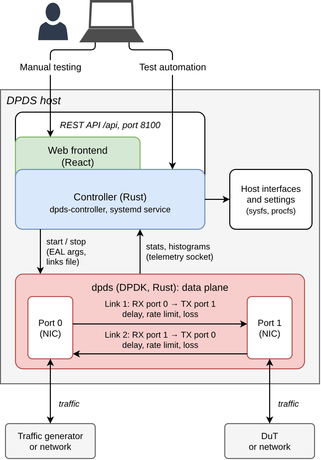

<div align="center">
  

  <h2>DPDS: A DPDK-Based Packet Delayer and Spacer</h2>

  
  
  
  
  
  [](https://github.com/uni-tue-kn/DPDS/actions/workflows/ci.yml)
</div>

---

## Overview

**DPDS** is a software **network-link emulator** written in Rust on top of [DPDK](https://www.dpdk.org/).
It sits between network interfaces and applies the three effects of a real link to a live packet
stream at line rate: **delay**, **rate limiting** and **packet loss**, with zero copies and no kernel
on the fast path. The emulation logic is the reusable library [`dpds-core`](crates/dpds-core/README.md).
This is the Rust port of the original C application.

Paper: [DPDS: A DPDK-Based Packet Delayer and Spacer](https://arxiv.org/abs/2606.17716) (arXiv:2606.17716)

- **Delay:** deterministic, normal, log-normal, gamma or uniform, optionally autocorrelated, with
  FIFO or send-time (reordering) packet order
- **Rate limiting:** Spacer (spreads packets out) or Token Bucket Filter (drops excess)
- **Loss:** random or Gilbert–Elliott (bursty); an optional `seed` makes runs reproducible
- **Directed links:** a link is one direction, from an ingress (RX) port to an egress (TX) port,
  with its own config. Two links make a bump-in-the-wire; three NICs can form a ring; one port can
  loop back.
- **Observable:** counters, drop causes, delay statistics and histograms
- **Controller and web frontend** to configure, start and stop DPDS (experimental)

This README describes how to use DPDS through its controller, with the web frontend or the REST API.
Running `dpds` directly, building and development: [docs/DEVELOPMENT.md](docs/DEVELOPMENT.md)

<div align="center">
  
</div>

The `dpds-controller` service on the DPDS host serves the web frontend and the REST API on one port
(8100). It starts and stops one `dpds` child process for all links, passing it the links and the EAL
arguments, reads its statistics and histograms over DPDK's telemetry socket, and reads the host's
network interfaces and settings for discovery and host hints. It stores nothing: the configuration
travels with every start request.

---

## Requirements

- Linux with **DPDK 26.07 or newer** (`pkg-config libdpdk`); for real traffic a DPDK-capable NIC
  (tested on Mellanox ConnectX) and hugepages
- **Rust** (stable) and **clang and lld with the same LLVM major version as `rustc`**
- **Node 26 or newer and npm**; the frontend is built on the host, which needs the npm registry
- One **isolated core per link** (kernel parameter `isolcpus`, see the host hints) besides the main
  lcore: a start without them is refused with a message that says so. A link uses exactly this one
  core (one RX and one TX queue), which bounds its packet rate: 100 Gb/s is reachable with large
  frames (8.1 Mpps at 1518 B), not with small ones (see
  [Performance tuning](docs/DEVELOPMENT.md#performance-tuning))

## Installation

`dpds.sh` builds and installs `dpds` and the controller and runs the controller as a systemd service.
It checks Rust, clang/`ld.lld`, DPDK and Node/npm first and never installs or tunes anything. Run it
as your user, not with `sudo`: it calls `sudo` itself for the privileged steps.

```bash
./dpds.sh check      # prerequisites, then the host hints
./dpds.sh install    # build dpds (telemetry) and the controller, install binaries and systemd unit
./dpds.sh start      # systemctl enable --now dpds-controller
./dpds.sh status     # also: stop, restart
./dpds.sh update     # switch to the channel's branch, pull, rebuild, reinstall
./dpds.sh uninstall  # remove binaries and unit; keeps /etc/dpds/controller.env
```

The web frontend is then at `http://<host>:8100/` and the REST API under `http://<host>:8100/api`.

The channel is set with `DPDS_CHANNEL` or a flag: `latest` (default, branch `main`, flag `--stable`),
`nightly` (branch `nightly`, flag `--nightly`) or a release tag such as `v1.0.0`. **`main` still
holds the C version of DPDS, which has no controller and no `dpds.sh`, so use `--nightly` for now**
(`./dpds.sh --nightly update`). The header of `dpds.sh` lists its other options and variables.

---

## Web frontend

Open `http://<host>:8100/`. The pages are in the navigation bar.

- **Dashboard:** **Start** sends the saved links to the controller; **Stop** and **Restart** act on
  the running emulation (a stop drains the delay buffers, which takes as long as the longest
  delay). The Summary tab and one tab per link show traffic rates and packet loss over time and, per
  link, the delay and IAT histograms. A failed start shows the log of `dpds`.
- **Settings:** the links to emulate, one row per directed link:
  - **RX port** and **TX port** are picked from the discovered interfaces; interfaces the host
    itself uses and ports already used by another link are disabled.
  - The **Histogram** pop-up switches delay statistics on or off and sets the bins and range of the
    delay and IAT histograms.
  - The **Settings** pop-up sets the buffer capacity, the seed and the delayer, limiter and loss
    stages, each of which can be switched off.
  - Buttons add, duplicate and delete links; **Save** stores the links and **Reset** discards the
    unsaved edits. Import and Export read and write the links as a JSON file.

  The links are stored in this browser only, the controller keeps nothing. A "pending restart"
  notice shows when the saved links differ from the running ones.
- **Interfaces:** the host's network interfaces with vendor, driver, MAC, state, speed, MTU, NUMA
  node and PCIe link, and whether DPDS can use each one and, if not, why.
- **Host hints:** how the host compares with the tuning recommendations, grouped into errors,
  warnings, info and OK. A hint comes with the commands an administrator runs as root to fix it,
  which can be copied. **Recheck** reads the host again.

---

## REST API

Base URL: `http://<host>:8100/api`. The interactive documentation of every route is at `/api/docs`,
the OpenAPI document at `/api/openapi.json`. Errors are `{"message": "..."}`.

| Route                                      | Purpose                                                                                 |
| ------------------------------------------ | --------------------------------------------------------------------------------------- |
| `GET /api/online`, `GET /api/version`      | Controller version, `dpds` binary and telemetry support; version and frontend            |
| `GET /api/interfaces`                      | Discovered network interfaces and whether DPDS can use them                             |
| `GET /api/host/hints`                      | Host hints (`?recheck=true` reads the host again)                                       |
| `POST /api/host/hints`                     | Host hints for the links of a start body                                                |
| `GET /api/emulation`                       | State (`stopped`, `starting`, `running`, `stopping`, `failed`) and running configuration |
| `POST /api/emulation/start`                | Start with a body of links (202; 400 invalid; 409 if not stopped or failed)             |
| `POST /api/emulation/validate`             | Check a start body and answer the lcores it would use, starting nothing                 |
| `POST /api/emulation/stop`                 | Stop (202; 409 if not running)                                                          |
| `GET /api/stats`                           | Live rates, loss, delay statistics and counters per link                                |
| `GET /api/stats/history`                   | Per-second history of the current or last run (`?since_ms=`)                            |
| `GET /api/stats/{dir}/delay_histogram`     | Delay histogram of a link (`?window_s=` 0, 10, 60 or 300)                               |
| `GET /api/stats/{dir}/iat_histogram`       | IAT histogram of a link                                                                 |

The body of start, validate and `POST /api/host/hints` is `{"links": [...]}`. A link has `ingress`
and `egress` (DPDK device names: a PCI address from `/api/interfaces`, or a vdev name such as
`net_null0`) and a `config`; `{dir}` is the link's index in the body, from 0. A `config` requires
`buffer_capacity` and `reordering`; `delayer`, `limiter`, `loss_model`, `seed`, `histogram`,
`iat_histogram` and `delay_stats` are optional, and a stage that is left out does nothing. Unknown
fields are refused. This is not the file format of `dpds` (see [docs/DEVELOPMENT.md](docs/DEVELOPMENT.md)):
the limiter is on when it is present (there is no `activate`), and the loss model is
`{"type": "Random", "p": 0.001}` or `{"type": "GilbertElliot", "p": .., "r": .., "k": .., "h": ..}`.
POST requests need `Content-Type: application/json`, `stop` too although it has no body.

Example: one link from `net_null0` to `net_null1` with a 10 ms normally distributed delay, a 10 Gb/s
Spacer and 0.1 % random loss. Use PCI addresses for real traffic.

```bash
API=http://localhost:8100/api

# start
curl -s -X POST "$API/emulation/start" -H 'Content-Type: application/json' -d @- <<'EOF'
{
  "links": [
    {
      "ingress": "net_null0",
      "egress": "net_null1",
      "config": {
        "buffer_capacity": 4096,
        "reordering": false,
        "delayer": {
          "distribution": "NormalDistribution",
          "mean_ns": 10000000,
          "std_ns": 3000000,
          "activate_correlation": false,
          "half_life_period_ns": 30000000,
          "initialization_rate_pps": 8100000
        },
        "limiter": { "mode": "Spacer", "rate_bps": 10000000000 },
        "loss_model": { "type": "Random", "p": 0.001 }
      }
    }
  ]
}
EOF

curl -s "$API/emulation"                  # "state": "starting", then "running"
curl -s "$API/stats"                      # directions[0]: rx_pps, tx_pps, loss_pct, delay_mean_ns, ...
curl -s "$API/stats/0/delay_histogram"    # delay histogram of the first link

# stop (drains the delay buffers first)
curl -s -X POST "$API/emulation/stop" -H 'Content-Type: application/json'
```

---

## Security

The controller runs as root and listens on all interfaces without authentication.
Anyone who reaches the port can start and stop `dpds` with their own validated configuration, but
cannot change the host. Restrict it with `DPDS_BIND=127.0.0.1:8100` before `install`, or edit
`DPDS_CONTROLLER_BIND` in `/etc/dpds/controller.env` and restart. `--allowed-host` /
`DPDS_ALLOWED_HOST` adds host names that may reach it, `--cors-origin` / `DPDS_CORS_ORIGIN` enables
CORS for the listed origins.

## Host hints

`dpds.sh check` and the frontend's Host hints page compare the host with the tuning in
[Performance tuning](docs/DEVELOPMENT.md#performance-tuning) and show the commands an administrator
runs as root to fix a hint. DPDS never changes the host: neither `dpds.sh`, the controller nor the
frontend writes a kernel, sysfs, NIC or firmware setting.

## Releases

The version is in `VERSION.md`; CI tags `v<version>` and creates a GitHub release
([releases](https://github.com/uni-tue-kn/DPDS/releases)) when a merge to `main` raises it.

---

## Cite

If you use DPDS in a publication, please cite:

E. Zink, F. Ihle, and M. Menth: [DPDS: A DPDK-Based Packet Delayer and Spacer](https://arxiv.org/abs/2606.17716), arXiv:2606.17716, 2026

```tex
@misc{ZiIh26,
  author    = {Zink, Etienne and Ihle, Fabian and Menth, Michael},
  title     = {{DPDS: A DPDK-Based Packet Delayer and Spacer}},
  publisher = {arXiv},
  year      = {2026},
  month     = jun
}
```

---

## License

Licensed under the [Apache License, Version 2.0](LICENSE).
